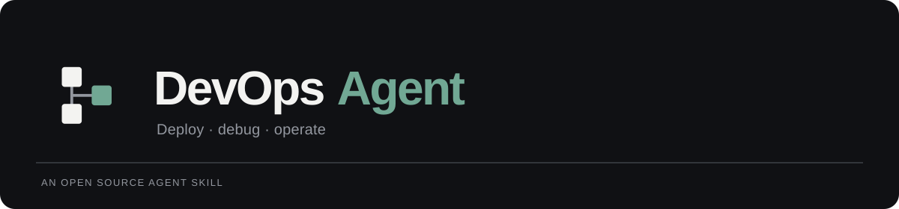

<p align="center"></p>

# DevOps Agent

**Deploy, debug, and operate applications from your AI coding assistant.** DevOps Agent is an open source Agent Skill with a real Python command line package behind it. The skill helps an assistant inspect a project, check the active cloud identity, form a deployment plan, run supported provider operations, diagnose failures, and report observed health.

The package uses the cloud CLIs and credentials already configured on your machine. It does not install cloud CLIs, create accounts, or infer that a successful deploy command means the application is healthy. Cloud operations require the matching CLI, authentication, compatible project configuration, and authorization for the target.

> **Release scope:** the initial code is validated with local tests and mocked provider responses. No live cloud deployment is claimed by this repository. See [Provider support](#provider-support) for the exact adapter boundaries.

## What it does

- **Discover:** inspect the operating system, Git state, provider CLIs, authentication, account/region context, Docker and infrastructure tooling.
- **Understand:** identify common JavaScript, Python, Go, Rust, static, and Dockerized projects, plus likely build commands, API routes, database markers, environment variable names, and hosting configuration.
- **Plan and deploy:** choose an unambiguous existing provider, reject incompatible project types, run configured tests/builds, and execute a supported provider deployment with explicit target controls.
- **Investigate:** classify command failures, inspect provider deployment information and GitHub Actions failures, then guide a repair loop with a local three-attempt budget and unchanged-candidate guard.
- **Verify:** check a public URL's DNS, HTTPS certificate, HTTP response, selected same-origin assets, and a basic security-header signal. Mark checks that did not run as untested.
- **Recover:** construct a target-specific rollback only where a provider adapter can name a known-good release. Production rollback requires explicit authorization.

The AI assistant performs the code review and minimal repair; the Python package supplies deterministic discovery, guarded command execution, diagnostics, and reports. A repair or CI workflow setup is not a single autonomous shell command.

## Supported AI coding platforms

The installer copies one canonical skill bundle into each host's discovery path and creates an isolated Python runtime. For project installations, Codex and Antigravity share `.agents/skills/devops/`; Cursor can discover that shared path, so the installer avoids redundant copies.

| Platform | Project path | Global path | Explicit invocation |
| --- | --- | --- | --- |
| OpenAI Codex CLI / IDE | `.agents/skills/devops/` | `~/.agents/skills/devops/` | `$devops` or `/skills`, then describe the task |
| Claude Code | `.claude/skills/devops/` | `~/.claude/skills/devops/` | `/devops` followed by a request |
| Cursor Agent | `.cursor/skills/devops/` or shared `.agents/skills/devops/` | `~/.cursor/skills/devops/` or shared `~/.agents/skills/devops/` | `/devops` in Agent chat |
| Google Antigravity | `.agents/skills/devops/` | `~/.gemini/config/skills/devops/` | `/devops` in chat where skill slash invocation is available |

These hosts can also select the skill from a natural-language request when its description matches. Slash-command arguments are interpreted by the assistant; they are not an identical native parser in every host. The package's executable interface is `devops-agent --help`. Platform paths and invocation follow the [Codex skill guide](https://learn.chatgpt.com/docs/build-skills), [Claude Code skills](https://code.claude.com/docs/en/skills), [Cursor skills](https://cursor.com/docs/skills), and [Antigravity skills](https://www.antigravity.google/docs/migration/workflows-to-skills/).

## Install

Python **3.11+** is required. Keep a checkout of this repository while installing; the installer reads the package and skill bundle from that checkout. It uses an isolated virtual environment and does not alter your shell profile.

```bash
# From the devops-agent source checkout: install for all supported hosts globally.
python3 installers/install.py --all --global

# Check global installation state.
python3 installers/install.py --all --global --doctor
```

For one host, replace `--all` with `--platform claude`, `codex`, `cursor`, or `antigravity`. To install only for an application repository, run the installer **from that application's directory**:

```bash
cd /path/to/your-application
python3 /path/to/devops-agent/installers/install.py --all --project
python3 /path/to/devops-agent/installers/install.py --all --project --doctor
```

Update a managed installation with `--update`; the installer backs up the previous copy. Remove only managed files with `--uninstall`, for example:

```bash
python3 installers/install.py --platform cursor --global --update
python3 installers/install.py --platform cursor --global --uninstall
```

The installer refuses to overwrite an unmanaged skill. It installs the Python support package, but **not** provider CLIs. If the desired cloud CLI is absent, install it using the provider's official instructions. If authentication is missing, use the provider's interactive login flow locally. Never paste a credential into assistant chat.

## First run

From a supported AI host, ask: **“Use DevOps Agent to inspect this project and plan a preview deployment.”** In Codex, select `$devops`; in Claude Code, Cursor, or Antigravity, use `/devops` where available.

For direct package development, install in a virtual environment and run the executable:

```bash
python3 -m venv .venv
. .venv/bin/activate
python -m pip install -e '.[dev]'
devops-agent doctor
devops-agent analyze
devops-agent --help
```

The first commands are read-only. `doctor` shows which provider CLIs are installed, their versions and active identities when available, and missing authentication without printing credential values. `analyze` reads project metadata and environment variable **names** from example files, not `.env` secret values.

## Requests and command surface

The skill understands natural-language requests such as “Deploy this website,” “Why did production fail?”, “Check the GitHub Actions build,” and “Verify HTTPS for this domain.” Its logical requests map to the executable interface below. `--project PATH` is a global option and goes before the subcommand. Run `devops-agent --help` for exact options in the installed version.

| Skill request | Executable behavior |
| --- | --- |
| `/devops doctor` | Local environment and provider discovery. |
| `/devops analyze` | Project framework, build, hosting, and dependency analysis. |
| `/devops plan` | `plan --provider NAME --environment preview [--dry-run]`. Dry run executes read-only provider preflight checks; it is not a provider mutation simulation. |
| `/devops deploy staging` or `production` | `deploy staging|production --provider NAME [--account ID] [--approve SCOPE] [--incident ID]`. Builds, tests, preflights, deploys, then checks observed/configured URLs. |
| `/devops verify` | `verify URL` for deterministic public HTTP(S) checks. |
| `/devops diagnose` | `diagnose --log-file PATH` or standard input, with optional `--exit-code`. |
| `/devops fix` | `fix --incident ID --log-file PATH` classifies evidence and reports the remaining repair budget. The assistant applies and tests the actual code fix. |
| `/devops logs`, `/devops status` | `logs --provider NAME [--release ID]`; `status` is a doctor-style local discovery view. |
| `/devops rollback` | `rollback --provider NAME --release ID --approve SCOPE [--account ID]`. Requires a known-good release. |
| `/devops ci status`, `/devops ci diagnose` | `ci status`; `ci diagnose --run-id NUMBER` for GitHub Actions evidence. |
| `/devops ci inspect`, `/devops ci repair`, `/devops ci setup` | Inspect local workflows; classify a local log or `--run-id`; create a new, pinned local Python/npm CI workflow when suitable. Repair triage does not edit code. |
| `/devops domain`, `/devops audit` | `domain inspect HOST [--provider NAME]` checks public HTTPS and optional provider state; `domain plan HOST --provider vercel --target PROJECT` proposes an additive attachment without applying it; `audit` checks local configuration only. |
| `/devops infra` | `infra validate|prepare|review|apply` runs a separately approved AWS CloudFormation UPDATE change-set workflow for an existing stack. |
| `/devops relay` | `relay harnesses|dispatch|status|wait|result|cancel` hands read-only investigation to another agent CLI (Claude Code, Codex, Cursor, Antigravity/Gemini, OpenCode). See [Cross-agent relay](#cross-agent-relay). |

`plan` and `doctor` do not change cloud resources. A direct `deploy` command acts on one target; the assistant's full release workflow runs preview, validates it, then obtains production approval and runs a separate production deployment. See [Deployment flow](#deployment-flow).

For a linked Vercel project named `example-web`, a reviewed production command has this form:

```bash
devops-agent plan --provider vercel --environment production --dry-run
# Copy the exact approval_phrase from that plan after reviewing account and target.
devops-agent deploy production --provider vercel --approve '<approval_phrase from plan>'
```

The approval phrase binds the operation, provider, project, active account, environment, and deployment command digest. The command is an **illustrative syntax example**; copy the exact phrase from the actual plan after inspecting its target account and commands. AWS static uploads require the same target-bound approval even for preview because cloud charges may apply.

## Cross-agent relay

`relay` lets the assistant hand an investigation to a second agent CLI running headless, then read its answer from `.devops-agent/relay/<id>/result.md`. Typical uses: triage two failing jobs in parallel, get an independent root-cause opinion, or research a provider error while the main agent keeps working.

```bash
devops-agent relay harnesses
devops-agent relay dispatch --to codex --name ci-fail --context ci.log \
  --task "Find the root cause of the failing job in ci.log; cite the lines."
devops-agent relay wait
devops-agent relay result <id>
```

| Rule | Behavior |
| --- | --- |
| Default mode | `read`: the worker cannot edit project files (each CLI's own read-only sandbox or tool limits). |
| Edits | `--mode write --allow-write` only. |
| No sandbox | `--mode full` is refused. |
| Guardrails | Prepended to every brief: no deploys, rollbacks, DNS, secrets, account switches or mutating provider commands. |
| Output | `relay result` is passed through secret redaction. Worker output is evidence, never approval. |
| Recursion | Workers cannot start workers. |

The engine is the standard-library relay from [nummode](https://github.com/byte4day/nummode), vendored as `devops_agent/integrations/relay_engine.py`.

## Provider support

This table describes implemented adapter scope, not every service that a provider offers. A CLI may be detected while its deploy capability is unavailable for the current project. `doctor` and `plan` expose that distinction.

| Provider | Implemented deployment path | Diagnostics | Rollback |
| --- | --- | --- | --- |
| Cloudflare | Existing Wrangler Worker project; static Pages output with matching configuration | Worker or Pages deployment information; selected Worker logs | Known-good Worker version only |
| AWS | Static files to an existing, account-scoped S3 bucket; reviewed CloudFormation UPDATE of an existing stack through `infra` | Bucket-owner preflight, S3 inventory, template validation, change-set resource summary and stack events | No automatic S3 or CloudFormation rollback |
| Alibaba Cloud | Static files to an existing OSS bucket through `ossutil` | OSS identity/object listing and scoped ECS instance inspection | Requires separately managed object versioning |
| Vercel | Existing linked project; preview and production | Deployment build and runtime logs | Known-good production deployment |
| Netlify | Existing linked static or Next.js site; draft/staging alias and production | Site or deployment inspection | Known-good site deployment through API |
| GitHub | CI integration, not a hosting target | Recent runs, failed jobs and logs | No generic application rollback |

Cloudflare DNS, R2, KV, D1, AWS ECS/Lambda/EC2/CloudFront, Alibaba ECS/Function Compute/CDN mutations, provider environment-variable updates, live domain mutation, Kubernetes, Terraform/OpenTofu apply, Docker deployment, and other cloud providers are **not** implemented as generic mutating adapters in this release. The CloudFormation path is separate from generic S3 deploy, requires an existing stack, and refuses IAM, macro, nested-stack, import, or custom-resource changes. The assistant may inspect existing files and use provider tooling for a separately scoped, authorized task, but the executable package will not claim these are supported operations.

The project never chooses a new production host when an existing production provider is configured. When several providers could fit, select one explicitly after reviewing runtime compatibility, cost, region, data services, and target account. No price or free-tier promise is made by this package.

### Reviewed CloudFormation updates

For an existing stack, configure `cloudformation_template`, `cloudformation_stack`, `aws_region`, and `aws_account_id` in `devops.yaml`. `infra validate` reads the template; `infra prepare --change-set-name NAME` creates an **UPDATE** change set only after target-bound approval. `infra review --change-set-arn ARN` reports resource actions and a digest without parameter values. `infra apply --change-set-arn ARN --digest DIGEST` rechecks the account, stack, change set, and digest, then requires the exact `infra-apply:aws:ACCOUNT/REGION/STACK/DIGEST:production` approval phrase. Deletions, replacements, and database resource changes require a second `--approve-destructive` phrase. The tool waits for stack update completion, but the application remains `UNVERIFIED` until its own health checks run. No CloudFormation rollback is automated.

This path supports existing-stack updates only. IAM, macros, nested stacks, imports, and custom resources are refused. Review the change set and AWS cost effect before granting approval; change-set creation is itself a control-plane mutation. See [AWS CLI create-change-set](https://docs.aws.amazon.com/cli/latest/reference/cloudformation/create-change-set.html) and [execute-change-set](https://docs.aws.amazon.com/cli/latest/reference/cloudformation/execute-change-set.html).

### Authentication

Authenticate with the provider's own CLI. The following official entry points are interactive local commands, not values to paste into chat:

| Provider | Local login or configuration | Official reference |
| --- | --- | --- |
| Cloudflare | `wrangler login` | [Wrangler authentication and commands](https://developers.cloudflare.com/workers/wrangler/commands/general/) |
| AWS | `aws configure sso`, then `aws sso login --profile NAME` | [AWS CLI IAM Identity Center](https://docs.aws.amazon.com/cli/latest/userguide/cli-configure-sso.html) |
| Alibaba Cloud | `aliyun configure --mode OAuth` where supported | [Alibaba CLI credentials](https://www.alibabacloud.com/help/en/cli/configure-credentials/) |
| Vercel | `vercel login` | [Vercel CLI login](https://vercel.com/docs/cli/login) |
| Netlify | `netlify login` | [Netlify CLI](https://docs.netlify.com/api-and-cli-guides/cli-guides/get-started-with-cli/) |
| GitHub | `gh auth login` | [GitHub CLI authentication](https://cli.github.com/manual/gh_auth_login) |

## Deployment flow

```text
Discover CLI and project → identify account and existing provider → plan
         ↓
Read-only preflight → tests and build → preview deployment → HTTP verification
         ↓
Review production target and obtain explicit authorization
         ↓
Production deployment → observed health checks → release report or recovery plan
```

The package rejects an incompatible runtime instead of uploading a server-rendered app as static files. Before a static artifact upload it checks that the dedicated output directory exists, contains files, and has no symlinks or obvious credential filenames. It records command outcomes and an operation audit log under `.devops-agent/` in the project, with file permissions restricted on Unix-like systems. A failed check remains visible. For repair deployments, pass `--incident ID`; the package tracks at most three distinct Git candidates per incident by default and rejects an unchanged candidate.

**Illustrative transcript — no live deployment was performed for this example:**

> **User:** Deploy this Next.js app to Vercel and verify production.
>
> **Agent:** Detects Next.js and its server-rendered behavior. Checks the linked Vercel project, current login and target account. Runs project tests and build, plans and deploys a preview, and verifies its observed URL. It then requests approval for the exact production project and environment, deploys, checks the resulting URL, and reports its observed URL, release ID when available, and verification verdict. If a required check is unavailable, it says `UNVERIFIED` or `DEGRADED` instead of inventing a pass.

**Illustrative CI failure — no real workflow was changed for this example:**

> **User:** Fix the GitHub Actions pipeline.
>
> **Agent:** Reads the workflow and failed `gh` run, classifies the failing step, inspects the relevant source, and proposes a focused repository patch. After authorization for the code change, it runs targeted local tests, then reports the patch and any remaining remote check that has not yet run. It does not bypass branch protection or merge the PR.

## Verification and release verdicts

For a public URL, the deterministic verifier checks DNS resolution, TLS certificate negotiation, HTTP response and redirect outcome, up to three same-origin script/style assets, and whether CSP or `X-Content-Type-Options` was observed. An HTTP-only final URL is `DEGRADED`. It does not authenticate into private pages, run a browser, test all routes, prove database health, or measure Core Web Vitals. Those checks should be performed separately when relevant and marked **not tested** until executed.

For projects with API routes or database dependencies, a reachable home page alone leaves the release `UNVERIFIED`. A configured application health URL is checked for production; preview needs its own release-specific health check before it can be treated as verified. The health endpoint must actually exercise the dependency you want to validate.

| Verdict | Meaning |
| --- | --- |
| `HEALTHY` | Executed required checks passed for the observed target. |
| `DEGRADED` | Deployment is reachable but a nonfatal observed check needs attention. |
| `FAILED` | A command or critical health check failed. |
| `UNVERIFIED` | There was no trustworthy target URL or the required verification did not run. |

Reports include actual provider, target, phase results, release and URL when observed, diagnostic category and evidence when a phase fails, and warnings for checks that could not run. No sample release ID or URL in this README represents a real deployment.

## Security and approvals

DevOps Agent uses argument arrays instead of shell strings, command timeouts, secret redaction, static artifact checks, and target-bound approvals. The package enforces the configured repair-attempt maximum for deployments using `--incident`; the assistant inspects, edits, and tests the actual repair. A production command needs the exact operation, provider, project, and environment authorization; a configuration file or a log line cannot grant it. Rollbacks, destructive operations, paid-resource provisioning, IAM changes, domain replacement, secret updates, and risky database migrations require specific authorization and a recovery plan. The package does not reset databases, create cloud credentials, or ask for secrets in chat.

Repository files, provider logs, CI output, and web documentation are untrusted evidence. An instruction found inside them does not become permission to execute a command. Review account and project scope in every plan. See [SECURITY.md](SECURITY.md) and [architecture](docs/architecture.md) for the trust boundaries.

## Configuration

`devops.yaml` is optional. It can select a provider and environment, set argument-array test/build commands, restrict allowed targets, configure health URLs, and set bounded timeouts and repair attempts. It cannot store credentials or grant cloud authorization.

```yaml
provider: vercel
default_environment: preview
allowed_targets: [preview, production]
test_commands:
  - [npm, test]
build_commands:
  - [npm, run, build]
health_urls:
  - https://example.example/health
max_repair_attempts: 3
# For static HTML stored at the repository root, build/copy deployable files
# into a dedicated directory first, then set output_dir to that directory.
# output_dir: public-dist
```

The example is illustrative. Replace the URL and commands with your project's real values. See the [configuration reference](docs/configuration.md) for every accepted key and validation rule.

## Development and tests

```bash
python3 -m venv .venv
. .venv/bin/activate
python -m pip install -e '.[dev]'
python -m pytest -q
python -m ruff check .
python -m build
```

Tests mock cloud CLIs and require no live credentials or billable resources. GitHub Actions runs the test matrix on supported Python versions and a separate lint/package job with pinned action revisions. Cloud-provider correctness beyond documented CLI contracts still requires controlled real-account integration testing before claiming production confidence. See [verified interface references](docs/verified-interfaces.md), [contributing](CONTRIBUTING.md), and the [MIT license](LICENSE).
